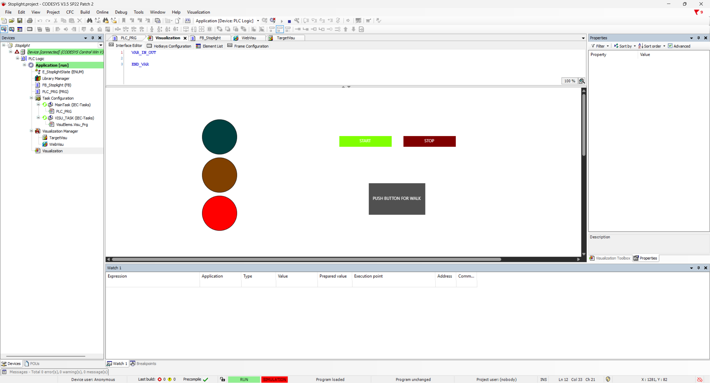

# PLC Traffic Light System

## Project Purpose
The purpose of this project is to practise fundamental PLC programming concepts using Structured Text (ST).

## Description
This project implements a simple traffic light control system with pedestrian request functionality.

The system cycles through green, yellow, and red lights using timers. A pedestrian request can trigger an early transition from green to yellow.

## HMI Visualization

The following screenshot shows the HMI interface used to monitor and interact with the traffic light system.

## Main Features
- Run/stop functionality.
- Traffic light sequencing.
- Timer-based state transitions.
- Pedestrian request detection.
- Rising edge detection.

## Operating States
- **OFF:** All traffic lights are turned off.
- **GREEN:** Green light is active until the timer expires or a pedestrian request is received.
- **YELLOW:** Yellow light is active for a predefined duration.
- **RED:** Red light is active for a predefined duration before returning to green.

## Technologies
- PLC Programming
- Structured Text (IEC 61131-3)
- State Machine
- TON Timers
- Rising Edge Detection

## Learning Objectives
Practise fundamental PLC concepts, including state machines, timers, digital inputs and outputs, edge detection, and sequential control.
